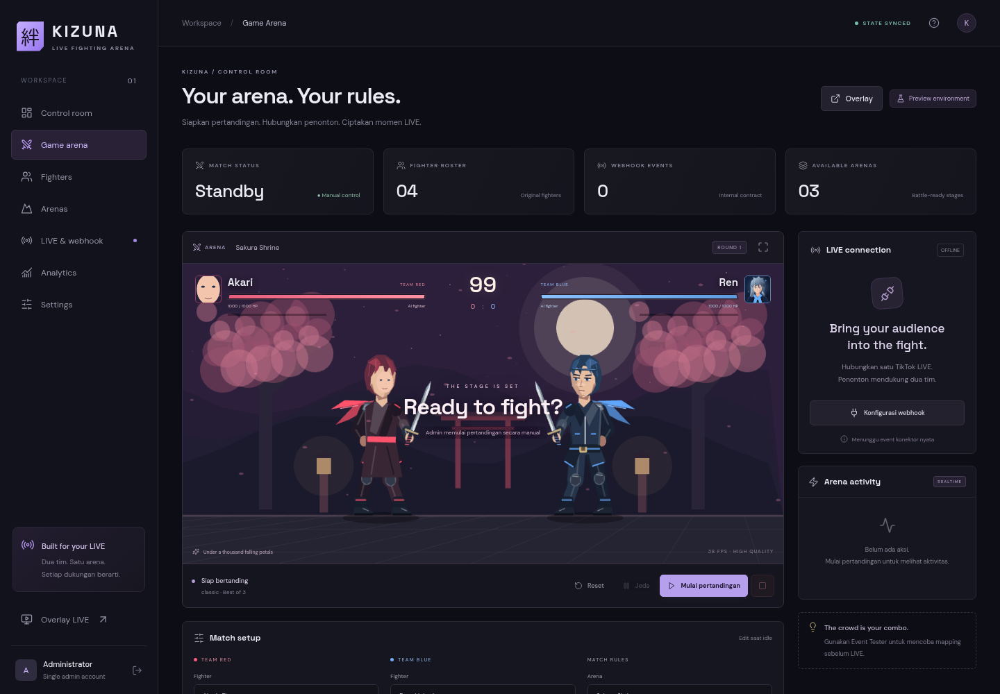

# Wajah dan pakaian terpisah

Di **Fighters → Edit → Character Creator**, pilih **Rig modular**. Rig memakai animasi dan statistik fighter yang sama. Mengganti wajah tidak membutuhkan spritesheet baru.

## Ganti wajah saja

Pilih wajah asli atau preset Akari/Ren/Yuki/Kuro. Biarkan model pakaian dan warna tetap seperti semula, lalu publish. Preset mengganti warna kulit/detail wajah; rambut dan kostum tetap mengikuti pilihan karakter. Skin pada tangan ikut menyesuaikan preset wajah. Pilihan ini bukan rekonstruksi wajah realistis dari foto.

## Upload wajah custom saja

1. Siapkan PNG/WebP wajah terpotong, ideal **280 × 340 px**, maksimal **1024 × 1024 px** dan 8 MiB. Gunakan background transparan; wajah menghadap kanan mengikuti rig tiga-perempat. Potong rambut, leher dan latar foto agar hanya area wajah yang diisi.
2. Upload pada **Wajah custom**; preview gambar muncul di editor. Upload otomatis memilih mode rig modular.
3. Biarkan pakaian, rambut dan statistik tetap sama. Klik **Publish fighter**, lalu pilih kembali fighter melalui Match setup saat idle dan klik Terapkan. Pertandingan aktif memakai snapshot sebelumnya.
4. Untuk kembali ke preset, klik **Hapus wajah custom**, pilih preset wajah dan simpan. File upload tidak langsung dihapus dari R2.

Wajah custom merupakan layer statis 28 × 34 unit rig. Layer mengikuti posisi kepala, arah, lompatan, crouch, dodge, serangan dan KO; tidak melakukan face recognition, rigging foto otomatis atau animasi mulut/ekspresi. Rambut asli tetap dirender; sesuaikan crop agar cocok dengan bagian tengah wajah. Bila gambar gagal dimuat, rig menampilkan wajah preset.

## Ganti pakaian saja

Pilih **Samurai**, **Jaket** atau **Jubah**, lalu atur warna kostum. Jangan mengubah wajah/upload/rambut. Pakaian digambar pada rig dan mengikuti pose tubuh; skill dan statistik tetap sama. Model pakaian berupa preset procedural, bukan upload pakaian bebas atau pemisahan pakaian otomatis dari foto.

## Spritesheet utuh

Spritesheet berisi wajah dan kostumnya sendiri. Pilih **Spritesheet utuh** untuk memakai gambar tersebut; wajah/pakaian modular tidak diterapkan. Saat memilih rig modular, aset sheet tidak ikut disimpan sebagai renderer aktif. File R2 tetap tersedia, tetapi upload sheet lagi jika ingin menggunakannya kembali setelah menyimpan rig. Panduan sheet lengkap: [CUSTOM_ASSETS.md](CUSTOM_ASSETS.md).

Perubahan wajah/pakaian menggunakan version dan snapshot fighter yang sama seperti editor combat. Duplikasi fighter menyalin tampilan; perubahan berikutnya tidak memodifikasi fighter asal. Upload mengikuti validasi endpoint aset dan publish menolak URL eksternal/aset hilang/ukuran wajah berlebih.

Contoh tampilan fixture QA: wajah custom pada fighter kiri dengan jubah, dan jaket pada fighter kanan.

