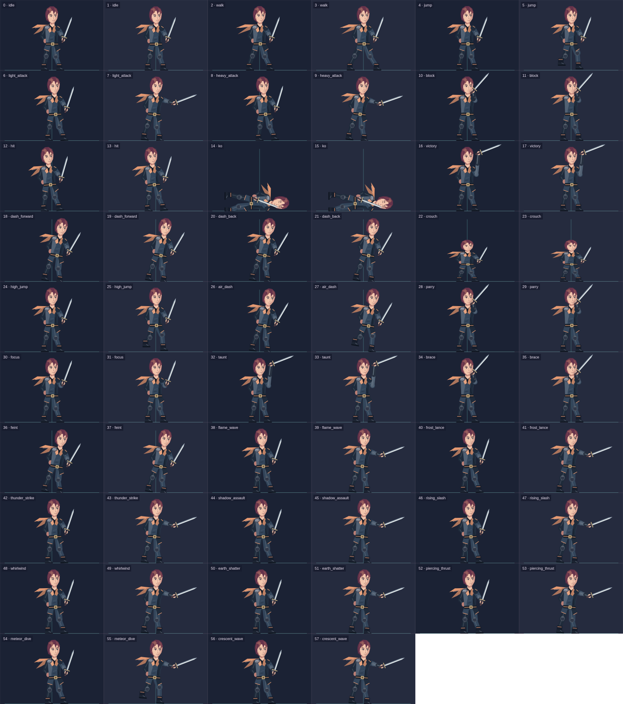
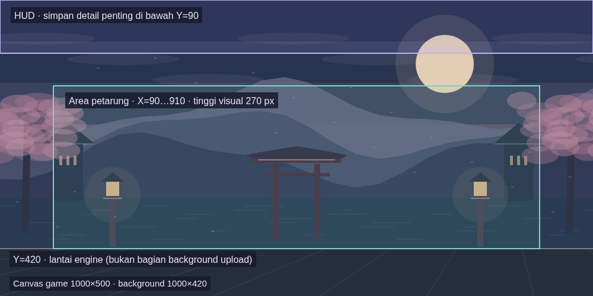

# Panduan gambar karakter custom dan arena

Untuk wajah/pakaian terpisah pada rig bawaan, lihat [CHARACTER_PARTS.md](CHARACTER_PARTS.md). Panduan di bawah membahas spritesheet seluruh tubuh dan background arena.

Panduan ini mengikuti editor yang sudah tersedia di KIZUNA. Contoh PNG di bawah dibuat dari rig game dan ilustrasi procedural orisinal, sehingga ukuran frame dan mapping dapat diperiksa secara tepat. Ini aset latihan impor dan acuan untuk artist; animasi contoh masih sederhana, bukan spritesheet anime produksi dengan semua keyframe unik.

## 1. File yang dipakai

| File | Ukuran | Kegunaan |
|---|---:|---|
| [fighter-core.png](examples/characters/fighter-core.png) | 2688 × 2736 | **Upload karakter:** 54 frame, 9 animasi dasar × 6 frame |
| [fighter-core-guide.png](examples/characters/fighter-core-guide.png) | 1344 × 1368 | Referensi bernomor; **jangan upload** versi ini |
| [fighter-core.json](examples/characters/fighter-core.json) | Metadata | Ukuran frame dan mapping start/end/FPS |
| [fighter-core-frames.csv](examples/characters/fighter-core-frames.csv) | 54 baris | Index, row, column, animation, phase |
| [fighter-all-actions.png](examples/characters/fighter-all-actions.png) | 2688 × 3040 | **Upload karakter:** 58 frame terpetakan untuk 9 dasar + 20 ability opsional |
| [fighter-all-actions-guide.png](examples/characters/fighter-all-actions-guide.png) | 1344 × 1520 | Referensi semua 29 animasi; **jangan upload** versi ini |
| [fighter-all-actions.json](examples/characters/fighter-all-actions.json) | Metadata | Mapping 2 frame per animasi; frame 58–59 kosong |
| [fighter-all-actions-frames.csv](examples/characters/fighter-all-actions-frames.csv) | 58 baris | Index lengkap untuk contoh semua aksi |
| [dusk-garden-background.png](examples/arenas/dusk-garden-background.png) | 1000 × 420 | **Upload arena:** satu background datar |
| [dusk-garden-preview.png](examples/arenas/dusk-garden-preview.png) | 1000 × 500 | Referensi komposisi arena dengan fighter dan lantai; **jangan upload** |
| [arena-layout-guide.png](examples/arenas/arena-layout-guide.png) | 1000 × 500 | Diagram HUD, ruang petarung dan lantai; **jangan upload** |
| [arena-props-atlas.png](examples/arenas/arena-props-atlas.png) | 512 × 512 | Contoh atlas 16 tile/prop; referensi pembuatan art, **belum dapat diimpor sebagai tilemap** |

Contoh JSON adalah lembar referensi, bukan tombol impor JSON: editor saat ini menerima file **PNG/WebP** lalu field mapping diisi manual. Jangan mengunggah guide bernomor, CSV, JSON atau SVG ke input spritesheet/background.

## 2. Karakter: grid, transparansi dan anchor


Contoh di atas memakai **448 × 304 px per frame**, **6 kolom**, tanpa margin atau spacing antar-frame. File upload aslinya transparan; warna kotak, garis anchor dan angka hanya ada pada guide. Semua pose menghadap **kanan**; game membalik gambar saat menghadapi lawan di sebelah kiri. Jangan menggambar dua arah berbeda pada sheet yang sama untuk satu mapping.

Index dimulai dari **0**, kiri ke kanan, lalu baris berikutnya. Pada grid 6 kolom:

```text
Baris 0:   0   1   2   3   4   5
Baris 1:   6   7   8   9  10  11
Baris 2:  12  13  14  15  16  17
...
Baris 8:  48  49  50  51  52  53

index = row × 6 + column
x = column × 448
y = row × 304
```

Gunakan canvas/frame berukuran sama untuk setiap pose. Anchor renderer adalah **center-bottom `(0.5, 1)`**: pusat tubuh berada di tengah frame, kaki pose berdiri berada pada batas bawah. Pertahankan anchor itu pada idle, walk, attack dan block agar karakter tidak bergeser saat berganti animasi. Untuk KO, komposisikan tubuh horizontal agar seluruh wajah, tangan dan senjata tetap berada di dalam sel. Jangan memakai trim otomatis, packing rotasi atau grid dengan gutter: loader saat ini memotong grid reguler tanpa membaca atlas JSON.

Karakter dirender dengan tinggi **frame 270 unit** di arena 1000 × 500. Skala = `270 / frameHeight`, bukan tinggi bounding box tubuh. Contohnya frame 304 px memakai skala 0,88816. Ruang transparan atas/samping ikut diskalakan; terlalu banyak padding membuat wajah kecil. Ruang transparan di bawah kaki membuat petarung tampak mengambang. Sediakan cukup lebar untuk ujung pedang dan rambut agar tidak terpotong atau masuk ke sel tetangga.

## 3. Mapping 9 animasi wajib

Gunakan **fighter-core.png**, bukan guide. Isi Frame width **448**, Frame height **304**, lalu mapping berikut:

| Animation | Start | End | FPS | Isi art yang disarankan |
|---|---:|---:|---:|---|
| `idle` | 0 | 5 | 8 | Napas, rambut/kostum bergerak halus |
| `walk` | 6 | 11 | 12 | Langkah kiri/kanan, weight transfer, kaki berpijak |
| `jump` | 12 | 17 | 10 | Persiapan/pose udara; perpindahan Y dikendalikan engine |
| `light_attack` | 18 | 23 | 15 | Anticipation → hit → follow-through → recovery |
| `heavy_attack` | 24 | 29 | 12 | Anticipation lebih besar, ayunan berat, recovery |
| `block` | 30 | 35 | 8 | Stance defensif, lengan/senjata di depan tubuh |
| `hit` | 36 | 41 | 12 | Recoil dan ekspresi terkena serangan |
| `ko` | 42 | 47 | 6 | Jatuh/pose tumbang, wajah dan senjata utuh |
| `victory` | 48 | 53 | 8 | Selebrasi yang berbeda dari idle |

Start dan End **inklusif**: 18–23 berarti 6 frame. Seluruh frame dalam range dimainkan sebagai loop selama state terkait aktif; renderer belum memiliki keyframe marker/one-shot akhir pose. FPS visual 1–60 berbeda dari simulasi combat **30 tick/s**. Mengubah FPS sprite tidak mengubah damage, cooldown atau timing hitbox server.

Idle, walk dan light attack harus menggunakan start frame berbeda. Gambar tunggal atau seluruh mapping ke frame 0 tidak memenuhi aturan publish. Beberapa frame contoh idle/block/hit/KO mengulang pose dengan perubahan kecil; untuk produksi, artist perlu membuat variasi keyframe yang sesuai, bukan hanya menggandakan gambar.

### Langkah impor karakter

1. Login admin → **Fighters → Buat fighter**.
2. Isi nama, statistik, elemen, special/ultimate dan warna template.
3. Upload **fighter-core.png**. Tunggu notifikasi upload berhasil.
4. Isi frame width **448** dan height **304**.
5. Buka **Mapping animasi spritesheet** dan isi tabel di atas. Range 0–53 seluruhnya berada di sheet.
6. Simpan draft jika belum selesai; klik **Publish fighter** setelah 9 animasi valid.
7. Klik ikon flask pada kartu fighter untuk preview di sandbox. Cek arah hadap, kaki, ujung senjata dan setiap pose.
8. Reset pertandingan utama bila perlu, pilih karakter published tersebut di Match setup lalu terapkan. Versi karakter pada pertandingan aktif tidak berubah saat profil diedit.

Warna rambut/kostum template hanya mengubah rig procedural; **tidak mewarnai ulang pixel spritesheet** yang sudah diupload. Untuk variasi warna custom sprite, edit art sumber dan upload sheet baru.

## 4. Contoh semua aksi dan skill



Untuk mencoba mapping lengkap, upload **fighter-all-actions.png** sebagai alternatif sheet core dengan ukuran frame **448 × 304**. Jangan memakai index sheet core untuk file ini. Contoh lengkap menggunakan **2 frame per animasi** supaya 29 animasi tetap memenuhi batas pixel upload. Frame 58–59 adalah sel kosong dan jangan dipakai. Semua start/end/FPS ada di [fighter-all-actions.json](examples/characters/fighter-all-actions.json).

| Animation | Start | End | FPS |
|---|---:|---:|---:|
| `idle` | 0 | 1 | 6 |
| `walk` | 2 | 3 | 6 |
| `jump` | 4 | 5 | 6 |
| `light_attack` | 6 | 7 | 6 |
| `heavy_attack` | 8 | 9 | 6 |
| `block` | 10 | 11 | 6 |
| `hit` | 12 | 13 | 6 |
| `ko` | 14 | 15 | 6 |
| `victory` | 16 | 17 | 6 |
| `dash_forward` | 18 | 19 | 6 |
| `dash_back` | 20 | 21 | 6 |
| `crouch` | 22 | 23 | 6 |
| `high_jump` | 24 | 25 | 6 |
| `air_dash` | 26 | 27 | 6 |
| `parry` | 28 | 29 | 6 |
| `focus` | 30 | 31 | 6 |
| `taunt` | 32 | 33 | 6 |
| `brace` | 34 | 35 | 6 |
| `feint` | 36 | 37 | 6 |
| `flame_wave` | 38 | 39 | 6 |
| `frost_lance` | 40 | 41 | 6 |
| `thunder_strike` | 42 | 43 | 6 |
| `shadow_assault` | 44 | 45 | 6 |
| `rising_slash` | 46 | 47 | 6 |
| `whirlwind` | 48 | 49 | 6 |
| `earth_shatter` | 50 | 51 | 6 |
| `piercing_thrust` | 52 | 53 | 6 |
| `meteor_dive` | 54 | 55 | 6 |
| `crescent_wave` | 56 | 57 | 6 |

Kesembilan animasi dasar tetap wajib saat publish. **20 mapping ability tambahan opsional**; bila kosong, game memakai pose dasar yang tersedia. Beberapa state taktis singkat dapat kembali ke idle/jump setelah lock selesai. Efek skill seperti petir, gelombang atau lance tetap digambar game secara terpisah; contoh sheet berisi tubuh dan senjata, bukan semua partikel. Tidak ada animasi `special_attack`/`ultimate` tersendiri pada editor saat ini: keduanya memakai fallback attack dasar dan efek game.

Jika membuat sheet produksi dengan lebih banyak frame, ubah ukuran grid/sel agar total pixel tetap di bawah batas. Misalnya 29 animasi × 6 frame × 448 × 304 = **23.697.408 pixel**, melebihi batas meskipun PNG sangat kecil setelah kompresi. Satu fighter saat ini menggunakan satu sheet; belum ada multi-sheet atau packing atlas non-grid. Pelajari biaya dan efek gameplay di [ABILITIES.md](ABILITIES.md); pose sprite tidak menentukan jangkauan serangan.

## 5. Arena custom: satu background datar


File yang diupload adalah [dusk-garden-background.png](examples/arenas/dusk-garden-background.png), **1000 × 420 px**. Preview di atas menambahkan petarung dan lantai untuk memperlihatkan komposisi; itu bukan file upload.

Renderer menampilkan background pada **X=0…1000, Y=0…420**; gambar di-stretch ke area itu. Lantai engine tetap pada **Y=420**, dengan area lantai hingga Y=500. Gunakan rasio 1000:420 untuk menghindari distorsi; ukuran alternatif 2000 × 840 juga memiliki rasio yang tepat. Pose karakter sekitar 270 unit tinggi dan pusat geraknya X=90…910.



Saat menggambar arena, tempatkan detail penting di luar area HUD atas. Pakai beberapa kedalaman ilustrasi: langit/bulan → pegunungan/cloud → bangunan → pohon/lampu. Flatten semua layer menjadi satu PNG/WebP sebelum upload. Layer kedalaman itu memberi kesan ruang, tetapi **tidak menghasilkan parallax otomatis**. Sisakan kontras di belakang wajah dan tubuh, serta batas visual lantai yang konsisten di bawah gambar.

### Langkah impor arena

1. Login admin → **Arenas → Buat arena**.
2. Nama: **Dusk Garden**; deskripsi: **Original sample · flattened background**.
3. Template: **shrine**; Accent: **#c591a4**.
4. Upload **dusk-garden-background.png** dan tunggu upload berhasil.
5. Biarkan hazard tidak aktif untuk contoh awal, lalu **Simpan arena**.
6. Reset pertandingan ke idle, pilih arena baru di Match setup, lalu terapkan.
7. Periksa kaki pada garis lantai, kontras kedua fighter dan HUD pada desktop/portrait.

Template mengatur floor/background procedural fallback dan partikel; upload custom background berada di atas bagian background template, sementara floor tetap digambar engine. Bangunan/pohon/batu di gambar adalah dekorasi, **bukan collision object**. Hazard aktif memakai konfigurasi server terpisah (X/radius/damage) dan otomatis mati pada competitive; gambar hazard di art tidak menghasilkan damage sendiri. Preset referensi ada di [dusk-garden.json](examples/arenas/dusk-garden.json).

## 6. Contoh atlas arena untuk artist


Contoh **512 × 512**, grid **4 × 4**, setiap tile **128 × 128**, tanpa gutter. Index 0–3 batu lantai, 4–7 lampu, 8–11 pohon sakura, 12–14 batu dekorasi, 15 penanda hazard. Koordinat tile ada di [arena-props-atlas.json](examples/arenas/arena-props-atlas.json).

Atlas ini membantu menyusun art arena pada editor gambar. **Editor KIZUNA belum memiliki tilemap/prop placement atau sprite animation arena.** Susun tile/prop menjadi komposisi akhir 1000 × 420 lalu ekspor satu background datar. Jangan upload atlas langsung sebagai background: seluruh kotak atlas akan tampil di arena, bukan otomatis dipasang sebagai objek. Rigging, destructible objects, trigger, parallax multilayer dan cuaca custom belum tersedia.

## 7. Batas file dan cek sebelum upload

| Parameter | Batas renderer/upload saat ini |
|---|---|
| Format upload | PNG / WebP |
| File maksimum | 8 MiB (8.388.608 byte) |
| Dimensi gambar | 8–8192 px pada kedua sisi |
| Jumlah pixel maksimum | 8.388.608 pixel |
| Ukuran satu frame karakter | 8–2048 px pada kedua sisi |
| FPS animasi | 1–60 |
| Packing | Grid reguler, index mulai 0, margin/spacing 0 |
| Facing karakter | Ke kanan; game flip horizontal |
| Anchor karakter | `(0.5, 1)`; center-bottom |

Contoh core = **7.354.368 pixel**, lengkap = **8.171.520 pixel**; keduanya memenuhi batas pixel dan ukuran file. Pakai sRGB, alpha transparan untuk karakter dan background tanpa karakter/HUD untuk arena. Sebaiknya dimensi sheet merupakan kelipatan tepat ukuran frame agar tidak ada baris/kolom sisa. Jangan menyimpan teks nama, nomor grid, checkerboard transparansi, garis panduan atau watermark ke PNG upload.

Cek file asli, bukan thumbnail GitHub: kanan-kiri pose benar, kaki konsisten, wajah terbaca, setiap sel utuh, range index berada dalam sheet, dan idle/walk/light attack berbeda. Setelah upload, periksa di sandbox karena validasi signature/container/dimensi tidak menggantikan penilaian kualitas animasi oleh artist.

## 8. Membuat ulang contoh

Source diagram/art ada di [asset-examples-scene.ts](../scripts/asset-examples-scene.ts), halaman renderer [asset-examples.html](../scripts/asset-examples.html), dan exporter [generate-asset-examples.mjs](../scripts/generate-asset-examples.mjs). Export memakai rig game dan Phaser Canvas, bukan screenshot overlay/admin. Exporter tidak login, mengirim input, atau memutasi state pertandingan.

Jalankan server pengembangan terlebih dahulu dengan `npm run dev`. Playwright hanya diperlukan untuk membuat ulang PNG, bukan menjalankan game. Contoh setup alat terpisah:

```sh
npm install --prefix /tmp/kizuna-doc-tools playwright
PLAYWRIGHT_MODULE=/tmp/kizuna-doc-tools/node_modules/playwright/index.mjs \
CHROMIUM_PATH=/usr/bin/chromium \
node scripts/generate-asset-examples.mjs
```

`CHROMIUM_PATH` harus menunjuk browser yang terpasang pada mesin Anda; tanpa variabel itu exporter memakai browser bawaan Playwright yang sudah diinstall. `DOCS_ASSET_ORIGIN` dapat disetel bila dev server memakai host/port berbeda. Contoh asset disertakan sebagai PNG/JSON/CSV sehingga pembaca panduan tidak perlu menjalankan exporter.

Art contoh dibuat orisinal dari kode repository; tidak menggunakan karakter anime/franchise pihak ketiga. Untuk artwork pengganti, gunakan desain yang Anda miliki atau berlisensi sesuai penggunaan game/LIVE.
