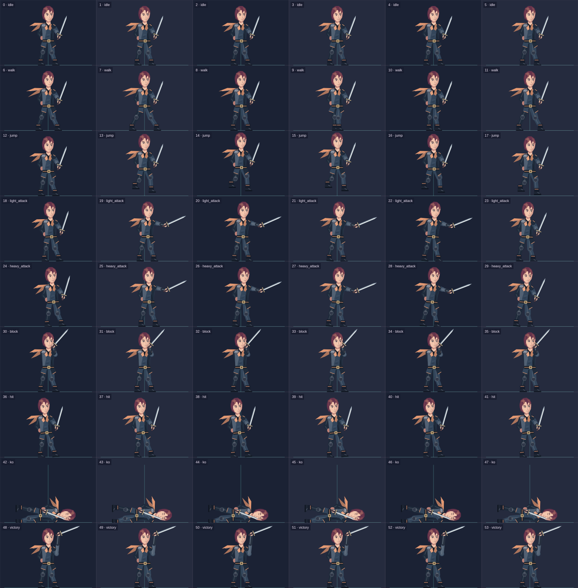
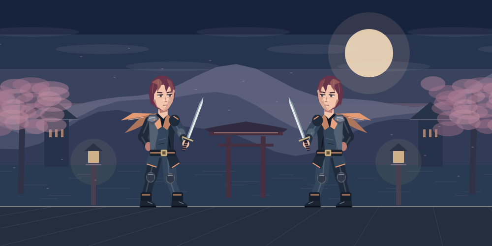
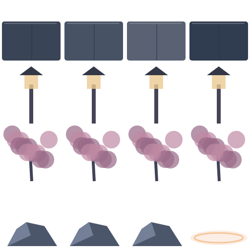

# Contoh gambar custom asset

Ikuti [panduan lengkap CUSTOM_ASSETS.md](../CUSTOM_ASSETS.md) untuk ukuran frame, index, animasi, langkah impor, serta batas editor.

**Upload:** [fighter-core.png](characters/fighter-core.png), frame 448 × 304, 6 kolom, 54 frame. **Referensi mapping:** [JSON](characters/fighter-core.json) · [CSV](characters/fighter-core-frames.csv). Guide di atas mengandung grid/nomor; jangan upload guide sebagai karakter.

Untuk seluruh animasi dasar + 20 ability: [fighter-all-actions.png](characters/fighter-all-actions.png) · [guide](characters/fighter-all-actions-guide.png) · [mapping](characters/fighter-all-actions.json). File ini memakai 2 frame per animasi, dengan index berbeda dari contoh core.

**Upload arena:** [dusk-garden-background.png](arenas/dusk-garden-background.png), 1000 × 420. Preview menambahkan fighter dan lantai engine, sehingga tidak dipakai sebagai background upload. [Diagram layout](arenas/arena-layout-guide.png) menunjukkan ruang HUD/fighter/lantai.

Atlas 16 prop/tile 128 × 128 ini untuk referensi artist. Editor saat ini menerima satu background datar; susun prop pada editor gambar dan flatten sebelum upload. Impor tilemap/atlas arena belum tersedia.
